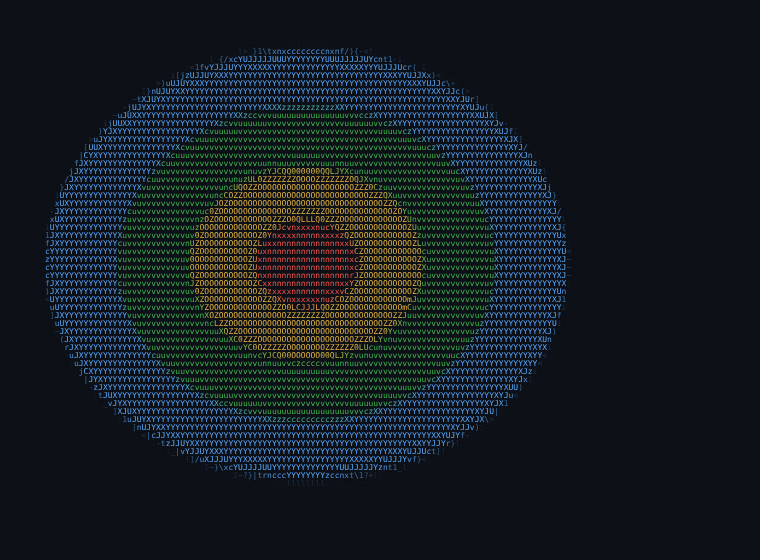

<div align="center">

# Image to ASCII

**Convierte cualquier imagen en arte ASCII — en tu terminal, un .txt o una página .html a color.**

  

[English](README.md) · **Español**

</div>

---

<p align="center"></p>

## Funciones

- 🖼️ Cualquier formato que abra Pillow (PNG, JPG, WEBP, GIF…), con la rotación EXIF corregida.
- 📐 Proporción correcta para los caracteres de la terminal: la imagen ya no sale aplastada.
- 🔤 Tres juegos de caracteres: `classic`, `detailed` (70 niveles) y `blocks` (`█▓▒░`).
- 🌗 Pensado para terminales oscuras, con `--invert` para fondos blancos o para imprimir.
- 🎨 Exporta a `.html` conservando el color original de cada pixel.

## Instalación

```sh
git clone https://github.com/RobiiAragon/Image-to-ASCII.git
cd Image-to-ASCII
python -m pip install -r requirements.txt
```

## Uso

```sh
python image_to_ascii.py foto.jpg                    # imprime en la terminal
python image_to_ascii.py foto.jpg -w 160 -r detailed # más ancho y con más detalle
python image_to_ascii.py foto.jpg -o arte.txt        # guarda como texto
python image_to_ascii.py foto.jpg -o arte.html -q    # HTML a color, sin imprimir
python image_to_ascii.py                             # te pide la ruta
```

| Opción | Descripción |
| --- | --- |
| `-w`, `--width` | Ancho en caracteres (por defecto `100`) |
| `-r`, `--ramp` | `classic`, `detailed` o `blocks` |
| `-i`, `--invert` | Invierte el brillo para fondos blancos |
| `-o`, `--output` | Guarda en `.txt`, o en `.html` para conservar colores |
| `-q`, `--quiet` | No imprime en la terminal |

## Licencia

[GPL-3.0](LICENSE)

---

Hecho por **[Jesús Aragón](https://github.com/RobiiAragon)** · [Portafolio](https://robiiaragon.github.io/portfolio/)
