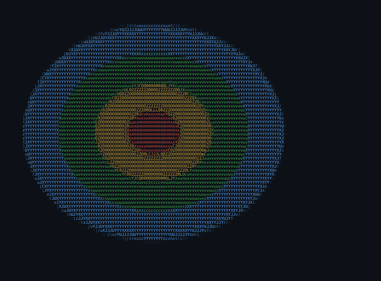

<div align="center">

# Image to ASCII

**Turn any image into ASCII art — in your terminal, a .txt file or a colored .html page.**

  

**English** · [Español](README.es.md)

</div>

---

<p align="center"></p>

## Features

- 🖼️ Any format Pillow can open (PNG, JPG, WEBP, GIF…), with EXIF rotation fixed automatically.
- 📐 Correct aspect ratio for terminal characters — no more squashed images.
- 🔤 Three character sets: `classic`, `detailed` (70 levels) and `blocks` (`█▓▒░`).
- 🌗 Made for dark terminals by default, with `--invert` for white backgrounds or printing.
- 🎨 Export to `.html` and keep the original colors of every pixel.

## Install

```sh
git clone https://github.com/RobiiAragon/Image-to-ASCII.git
cd Image-to-ASCII
python -m pip install -r requirements.txt
```

## Usage

```sh
python image_to_ascii.py photo.jpg                    # print to the terminal
python image_to_ascii.py photo.jpg -w 160 -r detailed # wider, more detail
python image_to_ascii.py photo.jpg -o art.txt         # save as text
python image_to_ascii.py photo.jpg -o art.html -q     # colored HTML, no terminal output
python image_to_ascii.py                              # asks for the path
```

| Option | Description |
| --- | --- |
| `-w`, `--width` | Output width in characters (default `100`) |
| `-r`, `--ramp` | `classic`, `detailed` or `blocks` |
| `-i`, `--invert` | Invert brightness for white backgrounds |
| `-o`, `--output` | Save to `.txt`, or `.html` to keep colors |
| `-q`, `--quiet` | Don't print to the terminal |

## License

[GPL-3.0](LICENSE)

---

Made by **[Jesús Aragón](https://github.com/RobiiAragon)** · [Portfolio](https://robiiaragon.github.io/portfolio/)
